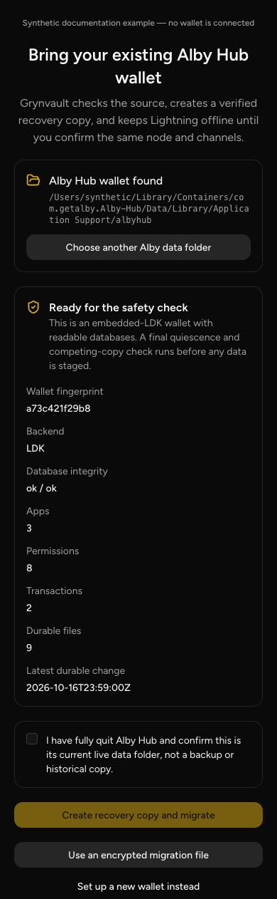
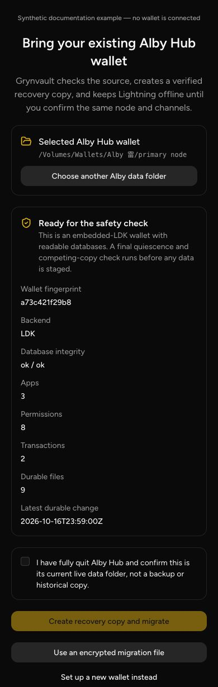
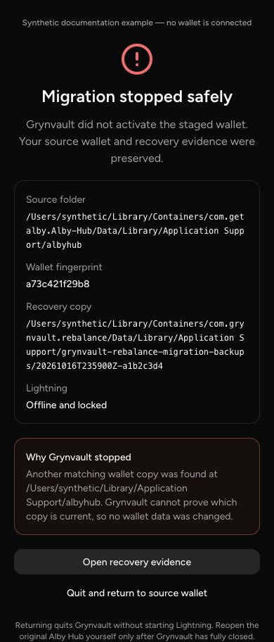
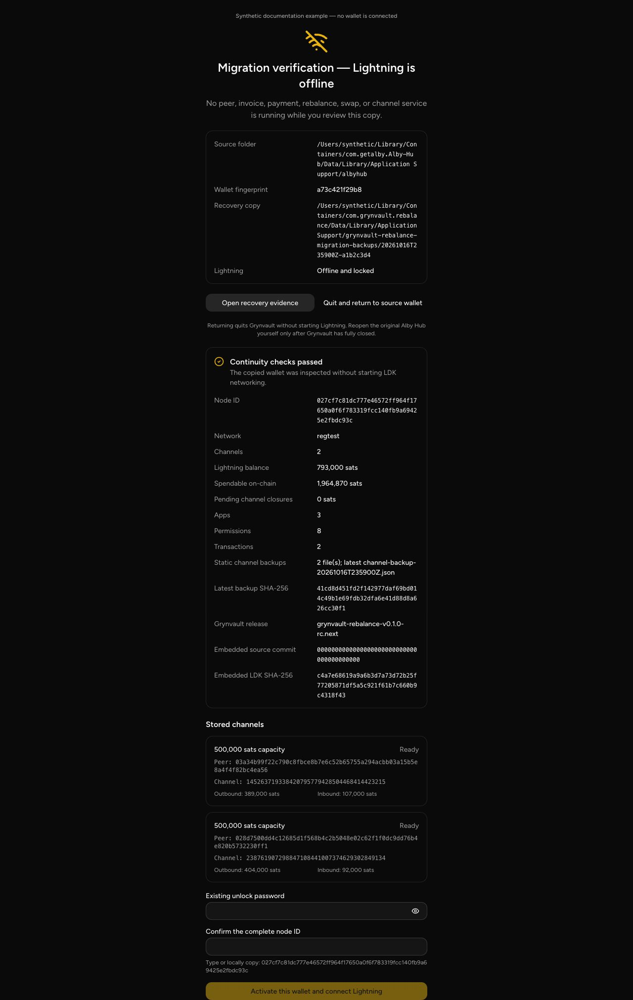
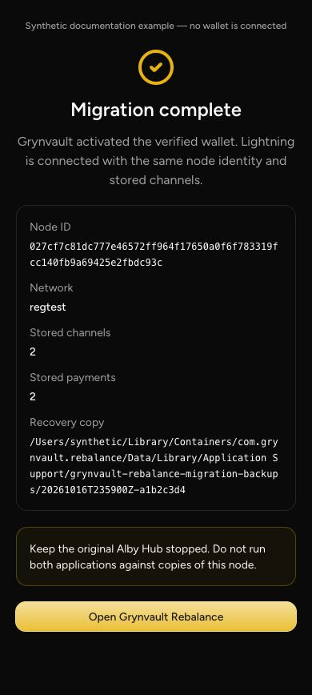

# Installation, guided migration, and recovery

Status: **implemented and synthetic/regtest accepted; owner-supervised release
acceptance is still required before publication**.

Grynvault Rebalance uses a separate product identity and data directory from
Alby Hub. It never silently opens the default Alby Hub directory. The guided
desktop flow is the supported way to bring over an existing embedded-LDK Alby
Hub wallet.

## Before you begin

- Use the Grynvault desktop application. Direct guided migration is not
  available through the hosted companion or HTTP build.
- Fully quit Alby Hub; closing its window is not enough.
- Select the current live Alby Hub data, not a backup, snapshot, or historical
  copy.
- Keep the source installation stopped until Grynvault reports **Migration
  complete**.
- Never run Alby Hub and Grynvault against separate copies of the same LDK node
  at the same time. A stale copy can cause peers to force-close channels.

No seed, unlock password, NWC secret, invoice, preimage, or signing key is sent
to a Grynvault website or stored in migration evidence.

## Guided flow

### 1. Find the source wallet

On macOS, Grynvault automatically checks the normal Alby Hub container. Select
**Choose another Alby data folder** when Alby uses a custom `WORK_DIR` or lives
on a locally attached external volume. Both source and destination must be on
filesystems macOS identifies as local; the importer rejects network-mounted
folders before it stages any data.

The picker accepts any of these levels and resolves the actual wallet folder:

- the Alby Hub application container;
- its `Data` directory;
- `Library/Application Support`;
- the parent of `albyhub`; or
- the exact `WORK_DIR` containing `nwc.db` and
  `ldk/storage/ldk_node_data.sqlite`.

Paths with spaces and Unicode are supported. Grynvault does not recursively
search the computer and does not upload the selected path.

### 2. Confirm the authoritative source

Before copying, Grynvault validates both SQLite databases, the embedded-LDK
backend, required wallet configuration, local wallet fingerprint, durable file
set, and known competing Alby/Grynvault locations. It checks that the source is
not open, takes two stability snapshots, creates a recovery snapshot, copies
only durable wallet state and static channel backups, and compares every copied
file by SHA-256.

While this work runs, the desktop screen reports only completed backend
checkpoints: source validated, source stable, recovery snapshot verified,
staged copy verified, and ready to restart. After relaunch, the persisted
quarantine state replaces transient copy progress so a restart cannot silently
fall through to ordinary wallet startup.

Migration stops without changing the wallet if another known folder contains
the same identity, if source authority is ambiguous, if either application is
using the data, or if any byte changes during the operation.

### 3. Restart into migration quarantine

After staging succeeds, Grynvault closes and relaunches. The staged data is
activated crash-safely, while any previous Grynvault target is moved intact
into the permission-restricted recovery directory.

The imported node remains offline below the UI layer. Auto-unlock, peer
connections, relays, invoices, payments, swaps, rebalances, and channel actions
are unavailable. Only migration status, offline verification, activation,
recovery-folder access, and safe return-to-source actions are allowed.

### 4. Unlock and verify offline

Enter the existing password only in the local application. Grynvault opens a
disposable offline copy of the LDK storage and compares:

- full node ID and network;
- exact stored channel IDs, peer public keys, capacities, and balances;
- stored payment history and wallet balances;
- NWC app, permission, transaction, and rebalance-record counts;
- static channel backup count and latest backup hash;
- source and destination byte-verification evidence; and
- embedded Grynvault release commit and LDK library hash.

Any identity or continuity mismatch leaves Lightning offline.

### 5. Activate once

Grynvault repeats the complete offline verification immediately before
activation. Enter the existing password and confirm the complete node ID. Only
then does it start Lightning networking, preserve a local acceptance record,
and clear the quarantine marker.

The completion screen confirms the activated node, stored channels and
payments, and recovery-copy location. Keep the original Alby Hub stopped.

## Recovery choices

While migration is offline:

- **Open recovery evidence** opens only the recorded local recovery folder.
- **Quit and return to source wallet** shuts down Grynvault without starting
  Lightning. Reopen Alby Hub yourself only after Grynvault has fully closed.
- **Archive failed attempt and restart** appears after a fail-closed stop. It
  preserves the failed staged/imported copy, control record, and evidence in
  the recovery folder, restores any prior Grynvault target, and then permits a
  fresh guided attempt. It never starts Lightning during the archive step.

If Grynvault reports a mismatch, activation failure, or ambiguous copy, do not
retry by moving files manually. Preserve the recovery folder and evidence, keep
all copies offline, and determine which data directory is authoritative.

Live migration and disaster recovery are different operations. The guided
importer rejects paths whose names identify backups, restores, or staging
areas. A historical backup may be internally consistent while still being
unsafe to start as the current Lightning node.

## Data locations and evidence

The initial macOS release uses:

- bundle identifier: `com.grynvault.rebalance`
- default Grynvault directory: `grynvault-rebalance`
- Grynvault desktop lock: TCP `127.0.0.1:21421`
- compatible Alby desktop lock: TCP `127.0.0.1:21420`

Each migration creates a restricted sibling folder named
`grynvault-rebalance-migration-backups/<timestamp>-<import-id>`. It contains the
unchanged Alby source snapshot, any pre-import Grynvault target, a redacted
evidence record, and—after activation—a migration acceptance record.

## Synthetic screenshot provenance

The five images above are rendered by the real migration component in a
development-only fixture mode. They contain only synthetic paths, node/channel
identifiers, balances, hashes, and timestamps. Fixture mode is unavailable in
production builds.

| File                            | Viewport/full-page size | SHA-256                                                           |
| ------------------------------- | ----------------------- | ------------------------------------------------------------------ |
| `default-path-390.png`          | 390 by 1262             | `4f12c03423656f76a6cb1e72abd36154ae77b53fcd3c0d049c2bf24a9033a061` |
| `custom-path-390.png`           | 390 by 1230             | `6cbb8a199b74317e573ed908c7928b6bd285db41145040d204224af52ea0ace6` |
| `stale-copy-block-390.png`      | 390 by 912              | `87d38c4cc17307c301ea3ec610b3089f9d113fd2faa1780de61894fdfd390d61` |
| `offline-verification-1280.png` | 1280 by 2022            | `91866112adbaa317f89a1f9addb300675dcc23a883f99cf084b61fc9829ca9bb` |
| `migration-complete-390.png`    | 390 by 868              | `73b0827415b703e629ba3c4a7398c00839694336a9f8b8a09932bd3a8a73bd35` |

The controlling engineering and acceptance requirements remain in
[`docs/grynvault-release/GUIDED_MIGRATION_PLAN.md`](docs/grynvault-release/GUIDED_MIGRATION_PLAN.md).
