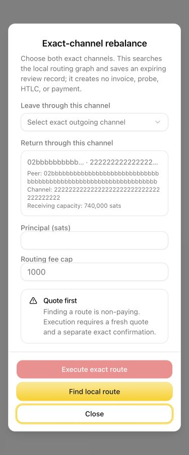
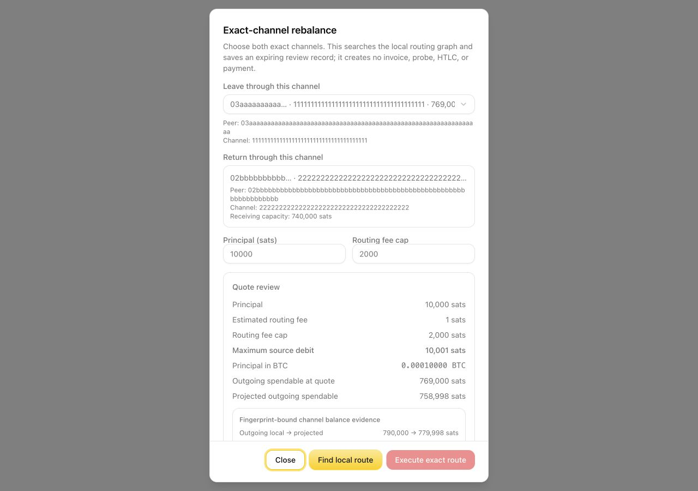
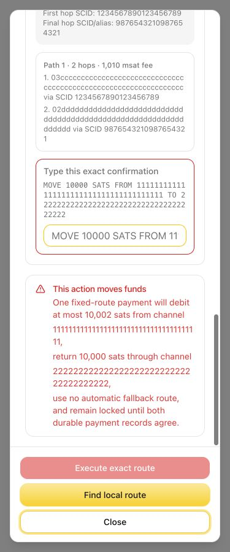

# Exact-channel rebalance

Exact-channel rebalance moves Lightning liquidity between two channels on the
same node. It sends one circular Lightning payment that must leave through the
selected outgoing channel and return through the selected incoming channel.
It does not move funds on-chain.

This is intended as an off-chain replacement for the former swap-based
rebalance workflow when that workflow is unavailable or unnecessarily creates
an on-chain leg. A rebalance still needs:

- one active channel with enough local, spendable outbound liquidity;
- a different active channel with enough remote, receivable inbound liquidity;
- a live public Lightning route between those exact channels; and
- enough headroom for channel reserves, in-flight HTLCs, and the routing fee.

If the node does not yet have inbound liquidity, obtain it separately before
using this flow. Options can include an LSP or JIT channel, a channel open from
another node, or a reviewed on-chain-to-Lightning swap-in service. Providers
such as Coinos can be evaluated for that separate step, but availability,
limits, custody model, and fees must be checked at the time of use.

## Find a route

1. Open **Channels** and choose **Rebalance In** from the channel that should
   gain outbound liquidity. This becomes the exact return channel.
2. Under **Leave through this channel**, choose the channel that should lose
   outbound liquidity.
3. Verify both full peer public keys and channel IDs.
4. Enter the principal and the maximum routing fee.
5. Select **Find local route**.

Finding a route is non-paying. It creates no invoice, probe, HTLC, or payment.

## Review the quote

Before execution, verify:

- the exact outgoing and incoming channel IDs;
- principal, estimated fee, fee cap, and maximum source debit;
- projected channel balances and `0 sats` expected on-chain change;
- quote expiry, first and final hop, and the route fingerprint; and
- the warning that there is no fallback route.

The quote is bound to the displayed route and channel evidence. If the quote
expires or the channel state changes, find a fresh route.

## Execute once

Execution is a real Lightning payment. Type the displayed confirmation exactly
and select **Execute exact route** only after a fresh owner review. Do not retry
or submit another rebalance while the operation is pending or being reconciled.

The terminal result must identify one of these outcomes:

- succeeded and reconciled;
- failed before payment submission;
- payment submitted but reconciliation still pending; or
- recovery required.

Treat a pending or recovery state as unresolved. Check the saved operation
status before attempting anything else. Never infer success from a changed
channel balance alone.

## Limits

Selecting exact endpoints cannot create missing network liquidity. A route can
still be unavailable because an intermediate channel lacks capacity, a peer is
offline, a fee or CLTV policy changed, or another payment consumed liquidity.
The fixed route is not retried through different channels.

The hosted Grynvault companion is informational only. It can verify release
metadata and explain bounded reason codes, but it cannot connect to a wallet,
find a live route, quote, sign, pay, or rebalance.

## Screenshot provenance

The screenshots in this guide were rendered from the real dialog component
using a local fixture. Every public key, channel ID, SCID, balance, quote ID,
fingerprint, and timestamp is synthetic. No wallet or live channel data appears
in the images.
